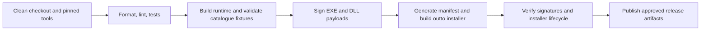

# Divvun Wind: standalone repository, outto and CI

Status: original production target plan, 2026-09-15. The development installer
and `dev-latest` pipeline are now implemented; [packaging/README.md](../packaging/README.md)
describes their current behavior and limitations. Historical prerequisite
statements below do not supersede the implemented installer launcher gate.

Original planning context: The independent repository
and local check/build script now exist; the source CI pipeline lives in
divvun-actions (see [CI integration](ci.md)). Installation and release orchestration
remain pending. See [implementation status](status.md) and the companion
[catalogue design](keyboard-label-catalogue.md). These are explicit product
requirements: the implementation belongs in a clean standalone repository, and
the installer must use **outto** through the existing **divvun-actions** patterns.

## Repository boundary

The repository is **`divvun-wind`**, short for **Divvun Windows Daemon**.
Keyboard label overrides are its first capability. Start with a focused Git
history and copy only the production source, required tests and design
documents. Record their origin and retain the applicable license notices.

```text
divvun-wind/
    Cargo.toml
    Cargo.lock
    crates/
        common/       # OS eligibility, shared catalogue and runtime contracts
        wind/         # divvun-wind.exe; one daemon per interactive user session
        wind-dll/     # divvunwind.dll; injected Wind runtime
        symbols/      # matching-symbol resolver and cache validation
    packaging/        # product metadata, lifecycle contract, manifest fixtures
    tests/fixtures/   # small catalogue and symbol-validation fixtures
    docs/
    README.md
    LICENSE-*
```

Keep the product identity independent of this first capability. The daemon owns
startup, process supervision, diagnostics and feature lifecycle. The keyboard
label capability owns its catalogue, Explorer hooks and refresh behavior. Future
capabilities can add their own modules and data contracts under the same product.
The current implementation scope remains the Windows 11 keyboard-label plan.

The keyboard catalogue remains `C:\ProgramData\Divvun\Keyboards\`; it does not
become a directory of general daemon configuration. Future feature data gets an
explicit location appropriate to that feature.

This is an independent Cargo workspace. It must build without `win-a11y-mcp`, a
sibling checkout, MCP, the general accessibility daemon, or any developer's
AppData contents. Internal path dependencies stay inside this repository. Copy
only the relevant locale contract from the existing common crate; do not carry
its general RPC/message protocol into the product.

Exclude experimental command execution, daemon/TUI/MCP crates, Ghidra projects,
Windows binaries/PDB downloads, symbol caches, logs, installed files, screenshots
and `target` contents. Keep diagnostic evidence as CI artifacts. Small synthetic
fixtures needed for deterministic tests remain source-controlled.

The current workspace's `windows-detours = { path = "../windows-detours" }` must
be replaced by an immutable dependency reference. Prefer a published release or
an exact Git revision with its required Detours sources available. Audit any
local changes before choosing that revision; a developer's uncommitted build
fixes cannot be an undeclared build input. Preserve dependency licenses.

Pin the Rust toolchain, Cargo lockfile, divvun-actions revision, outto toolkit and
Windows/MSVC build image. Pin downloaded dependency assets by immutable identity
and checksum. Build with `--locked`; do not silently float release builds to the
latest tooling. No build step copies dependencies from a person's SDK directory.
The CI image/artifact setup supplies the chosen debugger runtime distribution.

The acceptance test for this boundary is an empty Windows CI workspace containing
only a fresh checkout and the documented provisioned tools. It must build, test
and generate a local unsigned installer without developer credentials. Signing
and publishing are separate release capabilities.

## Existing outto pattern to reuse

Inspected `C:\Users\admin\git\divvun-actions` at commit
`4a3c9dfe5b5fd26d35d78858463432c275a97fb1`. The relevant implementation is:

| Existing source | Use in the new component |
| --- | --- |
| [util/outto.ts](https://github.com/divvun/divvun-actions/blob/4a3c9dfe5b5fd26d35d78858463432c275a97fb1/util/outto.ts) | `OuttoBuilder` generates a Windows TOML manifest with identity, files, directories, registry entries and lifecycle commands. |
| [actions/outto/lib.ts](https://github.com/divvun/divvun-actions/blob/4a3c9dfe5b5fd26d35d78858463432c275a97fb1/actions/outto/lib.ts) | `makeOuttoInstaller` calls `outto build --config ... --source ... --output ...`, optionally passing a signing command. |
| [actions/keyboard/build/outto.ts](https://github.com/divvun/divvun-actions/blob/4a3c9dfe5b5fd26d35d78858463432c275a97fb1/actions/keyboard/build/outto.ts) | Windows payload staging, `#{pf}` / `#{app}` destinations, hidden lifecycle commands and Divvun's signing invocation. Also the integration point for package-owned catalogue files. |
| [pipelines/outto.ts](https://github.com/divvun/divvun-actions/blob/4a3c9dfe5b5fd26d35d78858463432c275a97fb1/pipelines/outto.ts) | Existing Buildkite build/test/sign/artifact conventions and toolkit publication layout. This pipeline builds outto itself; the new component needs its own pipeline. |
| [docker/tools/outto.ts](https://github.com/divvun/divvun-actions/blob/4a3c9dfe5b5fd26d35d78858463432c275a97fb1/docker/tools/outto.ts) | How the Windows builder provisions the toolkit with `bin/outto.exe` and its companion `libexec` executables. |

The provisioning helper currently follows `dev-latest`. For component releases,
record and pin the actual resolved toolkit/image instead of treating that rolling
label as reproducible input. The helper's directory layout matters: the outto CLI
requires its installer/uninstaller companion binaries, not just `outto.exe`.

Add a thin product bundling action and Buildkite pipeline to divvun-actions, with
CLI routing following that repository's conventions. Proposed locations are
`actions/divvun-wind/bundle.ts` and `pipelines/divvun-wind.ts`. The pipeline
and repository dispatch are now implemented in the shared actions checkout;
the outto bundler remains planned. The product repository owns its source,
version, package contract and manifest expectations. The shared actions repository
owns orchestration and invokes the existing outto/signing helpers.

## Runtime package versus keyboard packages

The shared runtime has its own stable outto package identity, independent of any
feature or language: `no.divvun.wind`. Its display name is
`Divvun Windows Daemon`, its repository is `divvun-wind`, and its main executable
is `divvun-wind.exe`. The injected runtime DLL is `divvunwind.dll`; the symbol helper is `divvun-wind-symbols.exe`.

| Package responsibility | Manifest/lifecycle requirement |
| --- | --- |
| Runtime binaries | Install `divvun-wind.exe`, the keyboard label DLL and symbol helper under `#{pf}/Divvun/Wind`, with admin-managed files and normal-user execution. |
| Shared data directory | Create `#{commonappdata}/Divvun/Keyboards` with normal-user read access and preserve it during runtime uninstall. It contains keyboard-owned JSON files. |
| Keyboard definitions | Each keyboard package publishes and records its own arbitrarily named JSON files. Runtime installation does not seed demo keyboards or own another package's data. |
| Logon startup | Register the runtime for every interactive user session. A helper handles any lifecycle coordination not expressed by existing outto primitives. |
| Updates | Stage complete versions, coordinate watcher restart and retain loaded DLL versions until Explorer releases them. An upgrade must not force Explorer closed to overwrite a DLL. |
| Removal | Remove only this package's startup registration and owned binaries. Stop its watchers in the affected sessions and schedule cleanup of still-loaded files as needed. Preserve keyboard-package definitions. |

Use outto's install manifest to track file ownership, upgrades and uninstall.
Treat the existing PowerShell installer as a prototype reference, not the
production distribution mechanism. A narrow signed helper may perform startup
registration, migration and process coordination, but outto remains responsible
for packaging and installation. Define rollback for helper actions explicitly;
running a command does not by itself make its effects reversible.

Do not use outto's current `startup` shortcut location as proof of all-user
coverage: the inspected implementation resolves it through the current user's
profile. Verify the chosen all-session registration on two users, including a
user created after installation.

Keep the catalogue's complete-file publication contract. Verify outto's file
action/rollback behavior against it; if an action can expose partial JSON,
implement the required replacement behavior in outto or a narrowly scoped
publication action tracked by its manifest. Do not substitute a glob that can
overwrite or remove other packages' files.

## Outto prerequisites for the Windows 10 no-op

Both local outto checkouts identify commit
`9d5f1147ba68e7ba34b640912d355abf0a2692fb`. Inspection found:

- `PackageConfig.min_version` is parsed in `crates/core/src/config/types.rs`, but
  the inspected Windows install path does not enforce it.
- `crates/windows/src/lib.rs` reaches elevation/installation work and creates
  the installation directory before the `before_install` command phase.
- `crates/core/src/actions/run.rs` logs an unsuccessful child exit as a warning
  and continues. A `before_install` helper returning a nonzero code is not a
  successful skip of the whole component.

Consequently, setting `min_version` or adding an ordinary run hook is insufficient
for the agreed behavior. This is a concrete dependency to resolve in outto and
its builder surface before shipping the component installer.

Add an explicit successful unsupported-OS result, evaluated before the installer
UI/elevation and operational side effects. The package's gate must inspect the
real build and client/server classification using the same eligibility rule as
the runtime. Cover each emitted entry point, including any self-extracting stub;
wrapping an early-exit runtime inside an installer that already extracted files
does not meet the contract. Do not invent an unsupported TOML option in the
component manifest and assume it works.

If the label payload is part of a broader keyboard installer, scope the skip to
the label component so the normal Windows 10 keyboard installation continues.
All required install, file publication and registration steps need a failure
contract that actually fails/rolls back when required work fails. Implement or
verify that in the selected outto release instead of relying on warning-only run
hooks. The DLL/watcher/helper guards remain necessary even with installer gating.

## Build and release pipeline

Start with the already exercised `x86_64-pc-windows-msvc` target. Native ARM64 is
a separate target and verification effort; x64 emulation is not evidence of
compatibility with a native ARM64 Explorer.



1. **Validate source.** Check formatting, lint and run meaningful tests with the
   locked dependency graph. Include catalogue error/conflict behavior and shared
   OS classification. Pipeline-generation tests assert dependency edges so a
   failed test job cannot leave publication eligible.
2. **Build runtime.** Compile the watcher, hook DLL and symbol resolver from the
   fresh checkout. Stage only declared payloads and required licensed runtime
   dependencies. Save build/test results and component debug symbols as artifacts.
3. **Sign payloads.** Sign the product's EXEs and DLL before embedding them.
   The inspected outto CLI signs its own uninstaller and installer with `--sign`;
   that does not establish that arbitrary runtime files in the payload were
   signed. Verify all product signatures and keep vendor signatures intact.
4. **Package with outto.** Generate TOML through `OuttoBuilder`, validate the
   manifest against the pinned outto tool, and invoke `makeOuttoInstaller` with
   the staged source directory and Windows target. Use the existing
   `divvun-actions.bat sign` convention for the resulting installer. Require the
   uninstaller payload to be present.
5. **Verify the actual artifact.** Exercise the signed installer on clean Windows
   11 and Windows 10 VMs. Check Windows 10's successful no-op, first install,
   upgrade, repair, rollback, package ownership, two-user startup, and uninstall.
   Use Windows 11 interactive VMs for taskbar/menu tests and cold boot; a generic
   build container cannot supply that evidence.
6. **Publish.** Only a protected release job with successful dependencies publishes
   the tested artifact, checksums, version/revision information and validation
   results. Record Cargo/toolchain, divvun-actions, outto and builder-image
   identities. Define the GitHub/Pahkat channel in the product pipeline and verify
   that its payload type is supported; bundling an outto EXE alone does not prove
   updater integration.

Pull requests/local builds can produce explicitly unsigned test artifacts without
signing secrets. Release jobs must fail on a signing failure. Some existing
bundlers retry unsigned or rename unsigned output to the normal artifact name;
the new release pipeline must not inherit that behavior. Never promote an
unsigned fallback as a signed release.

The clean-build criterion is reproducibility from declared inputs. Do not claim
byte-for-byte identity of signed installers, whose signatures/timestamps can
differ. Preserve the unsigned build provenance and verify the final signed bytes
that are actually distributed.

## Work split and release gates

| Repository | Required work |
| --- | --- |
| New `divvun-wind` | Extract production crates and tests; pin dependencies; implement OS gate, catalogue loading, runtime lifecycle and diagnostics; own product metadata and documentation. |
| `divvun-actions` | Add component build/bundle/pipeline routing; use existing outto/sign helpers; wire artifact verification and gated publication; extend keyboard bundling to publish package-owned label JSON. |
| `outto` | Resolve successful early Windows 10 skipping, required lifecycle failure/rollback semantics and any publication guarantees needed by package-owned JSON. Expose the necessary supported settings through `OuttoBuilder`. |

The first implementation milestone is a new repository that builds independently
and produces a local unsigned outto installer through the shared action. The
first distributable pilot additionally requires OS gating in the complete
installer path, signed payloads, cold-boot/session evidence and upgrade/uninstall
verification. Catalogue live reload retains its separate UI-refresh completion
gate from the main plan.

This document records the target integration and implementation sequence.
The initial source extraction is local. No remote repository, CI secrets,
installer publication or change to the running prototype has been made.
