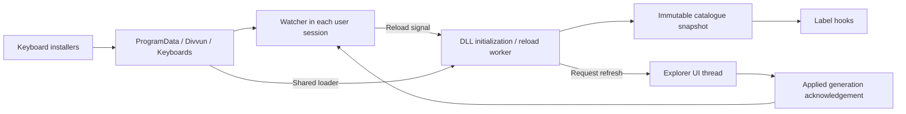

# Divvun Wind: keyboard label catalogue and implementation plan

Status: target design, 2026-09-15. Initial directory loading and runtime
extraction are implemented here; see [implementation status](status.md) for
completed work, verification and remaining release gates. The separately running
prototype still reads `C:\ProgramData\Divvun\locale-overrides.json`.

The implementation lives in the clean standalone **`divvun-wind`** repository
(**Divvun Windows Daemon**) and use **outto** for installation, following
**divvun-actions**. Keyboard label overrides are its first capability; the daemon's
identity allows further capabilities later. The companion
[repository, packaging and CI plan](keyboard-label-build-and-packaging.md)
records the inspected APIs, extraction boundary and release pipeline.

## Product contract

This component is **Windows 11 only**. On Windows 10 it must quietly do nothing:
normal execution returns success without installing, monitoring Explorer,
loading configuration, downloading symbols, or injecting/hooking anything.

Every keyboard installer can publish its own label definitions into
`%ProgramData%\Divvun\Keyboards\`, normally `C:\ProgramData\Divvun\Keyboards\`.
The DLL discovers the files and combines their contents. Installing or removing
a keyboard package must not require rewriting another package's file.

The filename has **no language or configuration semantics**. An installer chooses
any unique filename ending in `.json` and owns that path. There is no required
basename, language-derived filename, filename priority, central index, or runtime
registration call. Filename uniqueness must respect Windows' case-insensitive
path handling. Filenames may contain spaces or Unicode characters.

Windows continues to own installed input profiles, keyboard layouts, ordering,
and selection. These files supply label overrides only. A definition does not
install a keyboard or add an entry to the Windows selector.

## Windows eligibility gate

Check eligibility before any operational initialization, independently in each
entry point. Skipping the component on Windows 10 is a normal successful outcome,
not an installation error, warning dialog, or reason to fail the surrounding
keyboard installation.

| Entry point | Required behavior on Windows 10 |
| --- | --- |
| Component installer/update/migration | Skip the label component before copying its binaries/data, migrating files or registering startup. The surrounding keyboard installer can continue its normal work. |
| Watcher executable | Exit with code 0 before creating instance/event handles, logs/status files, directory watches, child processes or Explorer process handles. An old startup entry must not keep a background process alive. |
| Symbol helper | Exit successfully before cache writes, symbol downloads or shell inspection, including when launched directly. |
| Override DLL | If loaded directly, return successful inert initialization before spawning a worker, reading files, activating WinRT or installing hooks. DLL detach must likewise have no hook/worker cleanup to perform. |

Use one shared OS-classification rule. Both Windows 10 and Windows 11 report
major/minor version `10.0`, so a major-version test cannot distinguish them.
Use the actual OS build and client/server product type, without depending on
the host application's compatibility manifest. Windows 11 client builds start
at 22000; exclude Windows 10 and Windows Server. The build floor is an eligibility
check, not a promise of support for every later OS or shell build. Preserve the
separate supported-Windows-11 and matching-symbol compatibility checks.
If OS classification fails, remain inactive.
See Microsoft's [OS version table](https://learn.microsoft.com/en-us/windows/win32/sysinfo/operating-system-version)
and [Windows 11 release history](https://learn.microsoft.com/en-us/windows/release-health/windows11-release-information).

Normal unsupported-OS launches are silent. An explicitly requested diagnostic may
report `unsupported_os` as a successful skip. The binaries must themselves load
on Windows 10 so this guard can execute; do not introduce mandatory imports that
would produce a loader error before reaching it. Explicit uninstall remains able
to remove a previously installed component; the eligibility guard must not block
requested cleanup.

## Directory and format

For example, two unrelated installers could create:

```text
C:\ProgramData\Divvun\Keyboards\
    78f5c1a0.json
    installer-selected-name.json
```

The first file might contain:

```json
{
  "sjd-cyrl": {
    "abbreviation": "КИЛ",
    "display_name": {
      "en": "Kildin Sami",
      "ru": "Кильдинский саамский"
    }
  }
}
```

The second might contain:

```json
{
  "gem-runr": {
    "abbreviation": "RUN",
    "display_name": {
      "en": "Futhark",
      "ru": "Футарк"
    }
  }
}
```

A file can contain several language tags when its package supplies several
variants. Package identity stays in the installer; it is not inferred from the
language tag or filename. No package metadata wrapper is needed in version 1.

The format retains the current label structure:

| Element | Rule |
| --- | --- |
| Document | UTF-8 JSON object; accept an optional UTF-8 BOM. No comments or trailing commas. |
| Top-level key | A BCP47 language tag identifying the language being overridden. Validate syntax without requiring Windows or an IANA registry to recognize the language. |
| Tag matching | ASCII case-insensitive. `sjd-Cyrl` and `sjd-cyrl` identify the same entry; `sjd` and `sjd-cyrl` remain distinct. |
| Entry | Contains `abbreviation`, `display_name`, or both. Unknown properties are errors, so misspellings cannot silently do nothing. |
| Label | A nonempty string, or a nonempty object mapping UI-language tags to nonempty strings. Preserve Unicode text exactly; reject embedded NULs. |
| Missing/null field | No override for that field. An entry with neither usable field is invalid. |
| Empty document | Valid and contributes no entries. |
| Duplicate JSON members | Reject the file, including case-equivalent language or translation keys. Parsing must detect duplicates before inserting into a map. |

Both fields keep the existing localization behavior. For translations, try each
Windows UI-language preference in order, trying the complete tag and then its
parents (`ru-RU` to `ru`). Finally try `en`. A missing translation preserves
Windows' result. Literal strings apply in every UI language. The selected input
keyboard does not determine the UI language of the labels.

The abbreviation hook retains its current scope: supply an override when Windows
returns `ERROR_NOT_FOUND`. The display-name hook replaces the name of a configured
tag when a translation is available. Directory loading does not broaden either
hook's behavior.

## Shared loading and conflict rules

Use one loader implementation in the shared locale module for both the DLL and
watcher's validation command. It returns a catalogue plus structured diagnostics,
not just a map or a success/failure boolean.

1. Enumerate regular files immediately inside `Keyboards`. Include `.json`
   case-insensitively. Ignore subdirectories and other extensions; do not follow
   reparse-point files into other locations.
2. Read bounded, complete file contents and close the handles promptly. Initial
   product limits are 256 KiB per file, 1,024 candidate files, and 8 MiB total
   data read from candidates within the per-file limit. Skip oversized files
   individually without reading their full contents. These are loader resource
   limits, not Windows limits.
3. Parse and validate each file independently. Reject an invalid file as a unit;
   do not install a partially parsed package definition.
4. Normalize language and translation keys for comparison. Retain source paths
   alongside every accepted definition for diagnostics.
5. Group entries by language tag and resolve duplicates using the rules below.
6. Construct a complete immutable snapshot and publish it once. A hook never
   observes a half-built map or performs directory/file I/O.

Enumeration order and filenames must never determine the effective labels.
Sorting is allowed to make diagnostics reproducible, not to assign precedence.

| Situation | Effective result |
| --- | --- |
| One definition for a tag | Use it. |
| Identical definitions in several files | Coalesce them and record all contributing paths. Removing one file leaves the others effective. |
| Different definitions for the same tag | Disable that tag's override and report every contributing path. Other tags remain usable. |
| Different fields supplied by different files | Treat as a conflict; do not synthesize a definition through field-by-field merging. |

Equality compares normalized definitions, ignoring JSON object ordering and tag
case. Omitted and null fields are equivalent. A literal string and a translation
map are different definitions, even if their English text happens to match.

Allowing identical definitions handles multiple keyboard packages for the same
language. A conflict must never be resolved by install order, alphabetical order,
or a hidden preference for the migrated configuration.

## Errors and observable state

| Condition | Initial load | Later reload |
| --- | --- | --- |
| Directory missing or empty | Valid empty catalogue; watcher remains alive and waits for packages. | Confirmed removal/empty directory publishes an empty catalogue. |
| Malformed, unreadable or oversized file | Report the file; skip it; load valid files. | Retain that file's last accepted definition, if any, and mark it stale. New invalid files contribute nothing. |
| A file is confirmed deleted | No contribution. | Remove its contribution; do not retain deleted-package labels. |
| Directory cannot be enumerated, or aggregate limits are exceeded | Report catalogue unavailable; keep watcher alive without claiming active labels. | Retain the previous complete snapshot and report failure. |
| Valid definitions conflict | Exclude the affected tag and report conflict. | Recompute conflicts, including any retained stale files; exclude the affected tag. |

Last accepted definitions are retained in memory for the current DLL lifetime.
This design does not introduce another persistent catalogue cache. A cold start
cannot recover a malformed package file that was never successfully read; the
installer's validated replacement and rollback are the durable protection.

Directory contents can change during a scan. Retry a bounded number of times on
observed file replacement, disappearance, or inventory changes, then report an
unstable scan and retry later. A single file is the publication unit. The design
does not promise a filesystem transaction spanning several installers' files.

Diagnostics include source path, language tag when known, error code, and parser
line/column where available. Duplicate diagnostics list every source. Expose
catalogue counts, conflicts, stale sources, and a generation identifier through
status/check output. Do not log every string lookup.

Separate these facts in status:

- The watcher is running and the DLL is loaded.
- A particular catalogue generation is accepted in the DLL.
- Explorer's cached labels have been refreshed for that generation.

The watcher's independent validation scan must not be reported as proof of which
generation the DLL has loaded. The DLL needs to acknowledge its own generation.
An empty catalogue and a catalogue with errors must also remain distinguishable.

Provide two validation entry points using the same parser as the DLL:

- `check-file <path>` validates a staged package document before publication.
- `check --directory <path>` reports the effective catalogue, contributors and
  all conflicts/errors for a directory.

These commands perform validation without requiring Explorer, injection, or
symbol preparation. They return structured JSON and a nonzero exit code for
errors; identical duplicate definitions are informational, not errors. Runtime
loading can still use the valid subset when validation reports file errors.
Package installation must distinguish problems in its candidate definitions from
unrelated pre-existing errors; the latter are reported without making the new
package edit another owner's file.

## Installer ownership and publication

The production installer is an outto package generated through divvun-actions.
Outto owns the package install/upgrade/uninstall manifest; the prototype
PowerShell installer supplies reference behavior only. See the
[packaging plan](keyboard-label-build-and-packaging.md) for required outto work,
particularly the successful Windows 10 skip and lifecycle failure handling.

The common Divvun component owns the directory and runtime. Each keyboard package
owns its own file(s), tracked through that package's existing installer state.
Ordinary users need read access to the data; package installation manages writes.
Do not place executables, symbol caches, manifests, or diagnostic JSON files in
`Keyboards`, because every eligible JSON file is a label document.

For installation or upgrade:

1. Choose a unique destination when installing, or reuse the package's recorded
   destination when upgrading. Never overwrite a path owned by another package.
2. Produce and validate the complete document with the shared validator.
3. Write a temporary file in the same directory using an extension other than
   `.json`, then flush and close it.
4. Publish with a same-volume rename for a new file or a Windows replacement
   operation for an existing file. Preserve the required read permissions and
   retain the previous version for installer rollback outside the scanned files.
5. Verify publication and report success only after it succeeds. Sharing/access
   failures require bounded retries or a failed install; never delete the old
   definition first to make an overwrite succeed.

Windows provides [ReplaceFileW](https://learn.microsoft.com/en-us/windows/win32/api/winbase/nf-winbase-replacefilew)
for replacing an existing file while preserving attributes such as its DACL.
Its documented failure cases require explicit recovery; do not assume every
failed replacement leaves both paths untouched. Test the chosen installer
primitive under interruption and file-sharing contention.

On uninstall, remove only the package's recorded files. The shared runtime and
other packages' files remain. Renaming a package file is an ownership operation
for the installer and has no effect on language matching.

No central file-registration API is needed. For the initial release, the DLL
reads the directory at initialization. The later reload mechanism reacts to
publication/removal automatically.

## Runtime lifecycle

### Initial release: directory loading at DLL initialization

The existing per-session watcher and symbol-resolved hooks remain the foundation.
The DLL's initialization worker loads the directory using the shared loader,
then installs hooks against an immutable catalogue. Filesystem work stays outside
`DllMain` and hook callbacks. Microsoft's [DLL initialization guidance](https://learn.microsoft.com/en-us/windows/win32/dlls/dynamic-link-library-best-practices)
requires care around loader-lock activity; production extraction includes that
audit rather than adding directory work to the current entry point.

The watcher must stop treating missing/empty label data as a fatal asset error.
Keep binary/symbol validation separate from catalogue validation. When there are
no usable entries and no DLL is loaded, remain idle and periodically rescan so
the first installed package can trigger injection without restarting the watcher.

Once injected, an empty snapshot must be a supported pass-through state. In
particular, an install/uninstall racing DLL initialization must not leave a loaded
DLL with no meaningful readiness acknowledgement. Do not try loading a second DLL
to repair that state.

File changes after a snapshot is loaded take effect on the next Explorer start
in that session. Watcher restart alone does not reload the DLL. Report pending
changes and do not force Explorer restarts as an installer side effect. A normal
sign-in or an explicitly requested Explorer restart applies the latest directory.

### Later release: reload without restarting Explorer

The existing watcher observes the directory and signals invalidation to its
session's DLL. The DLL still reads the files itself using the shared loader.
No additional daemon or installer-maintained aggregate JSON is introduced.



Use asynchronous [ReadDirectoryChangesW](https://learn.microsoft.com/en-us/windows/win32/api/winbase/nf-winbase-readdirectorychangesw)
with subtree watching disabled. Coalesce bursts for approximately 250 ms and
rescan the directory instead of interpreting notifications as a complete change
log. Arm observation before the initial scan, reconcile after notifications,
rescan on overflow, and periodically reconcile to recover missed changes.
Handle deletion/recreation of the directory by observing its parent or retrying
registration; notifications for a directory do not report changes to that
directory itself.

Use a narrow, session-scoped reload signal and acknowledgement keyed to Explorer
PID and creation time, with an ACL for the owning user/system. The protocol
requests catalogue reload only; it does not accept paths or function addresses.
Give it a versioned status format so older loaded bundles can report that reload
requires an upgrade. Every active user session receives its own update.

The worker builds a new snapshot off the UI thread. Replace the current
`OnceLock<LocaleConfig>` with an immutable, reference-counted snapshot held in a
short-lock container. Each callback retains its snapshot for the call; no lock is
held across original Windows calls. Generation identifiers describe the normalized
effective contents, so moving/renaming identical files need not refresh the UI.
Source inventory and diagnostic changes are tracked separately.

Swapping the map is only half of reload. The current taskbar refresh hook detaches
after one natural `UpdateCurrentData` call; it cannot acknowledge repeated reloads.
Implement a repeatable, coalesced refresh request on Explorer's owning UI thread,
guarded against reentrancy and object destruction. Do not retain an unowned raw
`this` pointer or call the taskbar model from the directory-watching thread.

The safe dispatch mechanism is an implementation investigation, not a capability
already proved by the prototype. Completion of live reload requires a verified
way to refresh both the taskbar indicator and reopened selector on supported
builds. Until then, report a loaded generation as `refresh_pending`; do not claim
that new labels are visible merely because parsing succeeded. Require the next
Explorer start if that build has no supported refresh path.

Uninstall and correction must use this same mechanism: removed overrides must
restore Windows' labels, and correcting a conflict must restore the valid custom
label. Disable/stop cancels outstanding observation cleanly; it must not unload
code while callbacks or worker threads can still execute it.

## Migration from the current single file

Migration belongs to the installer. The directory loader must not read or merge
`%ProgramData%\Divvun\locale-overrides.json`, LocalAppData files, or temporary
experiment files as fallbacks.

1. Parse and validate the current shared file and back it up outside `Keyboards`.
2. Copy its unchanged definitions into a new uniquely named, installer-owned
   JSON file in `Keyboards`. A migration record in installer state remembers the
   destination so retries are idempotent; the filename has no special meaning.
3. Validate the combined directory, including any package files already present.
   Report conflicts before switching the runtime. Never overwrite existing files.
4. Install the new runtime and startup registration, then verify directory loading.
   Keep the old source until the new reader is verified; a loaded old DLL may
   continue using its existing in-memory snapshot until Explorer exits.
5. Archive the old source after successful verification. A rollback restores it
   before restoring a runtime that expects the single-file format.

Migration cannot infer which real keyboard package owns historical hand-written
entries. The migration installer initially owns the imported file. As real
keyboard packages adopt those definitions, an explicit installer migration must
remove the adopted tags from the import. Ordinary packages must not edit a file
they do not own. Identical definitions can coexist during the transition;
differing definitions require resolving ownership before publication.

The runtime installer stops seeding sample keyboards on fresh installations.
Examples are development fixtures. A fresh shared component with no keyboard
packages has an empty directory and an idle, healthy watcher.

## Implementation sequence and completion criteria

All steps below are planned, not implemented by this document.

| Step | Concrete changes | Completion criterion |
| --- | --- | --- |
| R. Standalone repo and pipeline foundation | Create the independent `divvun-wind` workspace, extract only production sources/tests, pin all dependencies and add a divvun-actions build/bundle adapter using outto. | A fresh checkout builds and tests without this experimental repo or sibling checkouts and produces an explicitly unsigned local outto artifact. |
| 0. Windows 11 eligibility | Add the shared OS classification and early guards to the watcher, DLL, symbol helper and component installer/migration. | On a real Windows 10 system, direct executable launch, direct DLL loading and the component install step all succeed without operational side effects. Classification failure also stays inactive. |
| A. Shared catalogue loader | In the new repo's shared crate, add the directory resolver, duplicate-aware parser, validation, normalization, conflict handling, source tracking and structured diagnostics. Reuse existing localization resolution. | Fixture tests produce the same effective catalogue for every file order and filename choice; failure-isolation tests pass. |
| B. DLL and watcher integration | Replace single-file reads in the DLL and `validate_assets`; support empty/degraded catalogues and loaded-generation reporting; keep callbacks free of filesystem I/O. Add `check-file` and `check --directory` for package/fixture validation, while production uses the fixed ProgramData location. | The actual menu uses definitions from at least two arbitrarily named files after injection; a malformed third file does not suppress valid labels. |
| C. Outto ownership and migration | Implement the outto manifest/action contract, complete-file publication, validation and idempotent legacy migration through divvun-actions. Resolve required outto OS-skip and failure-handling gaps. Keep sample data out of fresh production installs. | The generated outto install, upgrade, repair, rollback and uninstall affect only owned files. Existing English/Russian text survives migration exactly. |
| D. Production pilot package | Use the clean pipeline to sign payloads, build/sign the outto installer and verify its lifecycle. Install binaries in Program Files, shared data in ProgramData, and startup for every user session. Add repeated-crash suppression and useful diagnostics. | Release publication depends on successful tests and signature verification; clean-machine install, cold boot, sign-in, Explorer recovery, offline cached-symbol startup and two-user operation pass on the declared supported builds. |
| E. Live reload | Directory observation, cancellation, reload/acknowledgement protocol, snapshot replacement and repeatable UI-thread refresh. | Add/update/remove definitions while Explorer stays running; verify actual menu and indicator changes, generation acknowledgement, and recovery from malformed/conflicting updates. |

R establishes the repository and pipeline in which implementation proceeds.
Step 0 precedes deployment of any other step. A precedes B and C; B and C precede
the pilot. E builds on A/B and is a separate
release gate. The pilot explicitly documents initialization-time loading. Other
production work still includes matching-symbol compatibility checks, dependency
packaging, rollback and shell-crash protection; changing storage does not resolve
those existing productization requirements.

## Verification matrix

| Area | Required evidence |
| --- | --- |
| Clean build and outto | Fresh standalone checkout with declared tools only; no sibling dependencies, SDK copying from a developer profile or prior artifacts. Verify the emitted outto manifest and signatures on both runtime payloads and final installer. A test/signing failure blocks release publication. |
| OS gating | Unit cases for Windows 10 client builds (including 19045), the 22000 boundary, supported Windows 11 clients, Server product types and failed version queries. On real Windows 10, launch the watcher/helper, directly load the DLL, and run the component installer: success, no persistent process, no hooks, no Explorer access, no file/task changes and no network requests. Verify the surrounding keyboard install still succeeds. |
| Filename independence | Rename files to unrelated names, including spaces/Unicode/mixed-case `.JSON`; reorder enumeration; confirm identical labels. Ignore nested JSON and non-JSON staging/backup files. |
| Format | Fixed and translated labels, multiple tags per file, UTF-8/BOM, unknown languages, case normalization, malformed JSON, duplicate members, misspelled fields and size/count limits. |
| Ownership/conflicts | Two unrelated packages; identical shared tag; removal of one identical contributor; conflicting tag with unaffected valid tags; conflict correction. |
| Failure isolation | Invalid third package, unreadable source, interrupted replacement, inaccessible directory and limit exhaustion. Verify diagnostics and the documented empty/stale/unavailable distinctions. |
| Localization | `en-US`, `en-GB`, `ru-RU`, `ru-BY`, unsupported-language fallback and plain strings through real hooks. Inspect the actual selector under English and Russian UI installations for the pilot. |
| Migration | No legacy file, valid legacy file, already populated directory, conflicts, interrupted/repeated migration and rollback. Compare migrated Unicode data and preserve existing owned files. |
| Session/startup | Empty directory before first package, cold boot/sign-in, two users, Explorer restarts, watcher restarts, disabled feature and uninstall. Prove which catalogue generation each DLL loaded. |
| Live reload gate | Rapid replacements, concurrent lookups, directory deletion/recreation, notification loss/overflow, deleted last file, corrupt replacement with recovery, repeated cache refresh and safe shutdown. |

No reboot, deployment, runtime configuration change, or Explorer restart is part
of writing this plan. Implementation should attach test results and live-menu
evidence to the corresponding steps rather than treating this design as proof.
